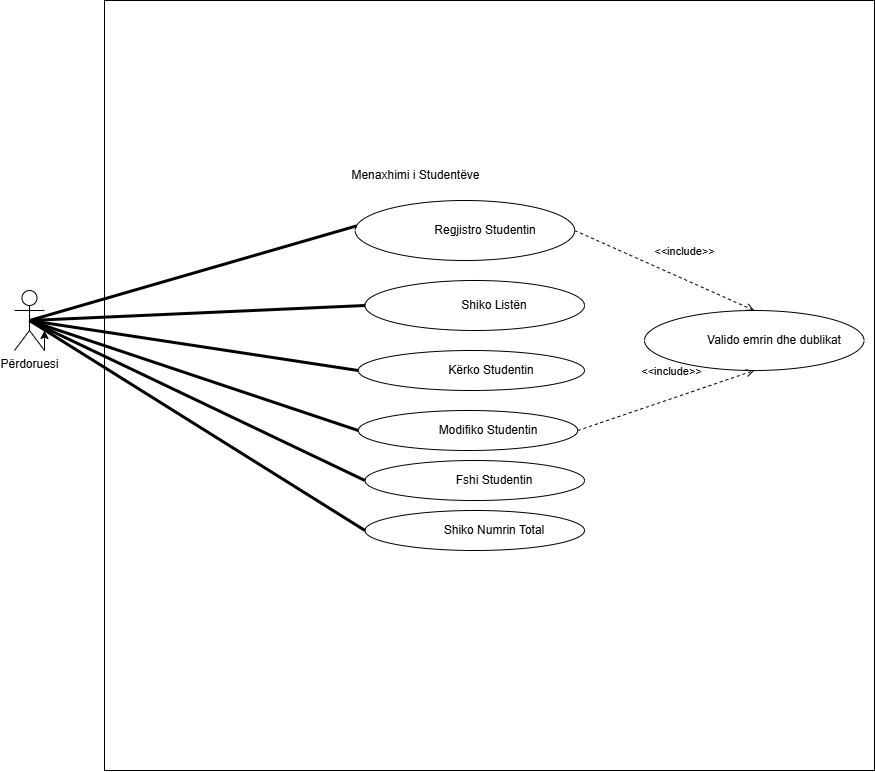
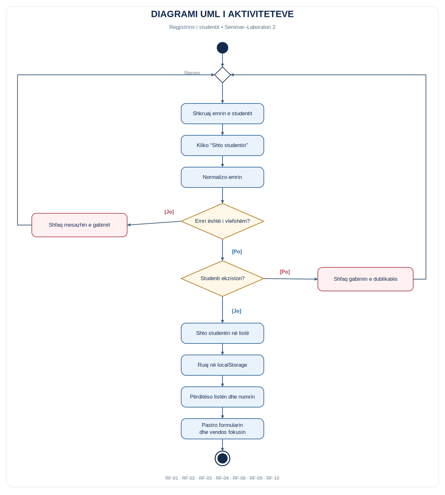
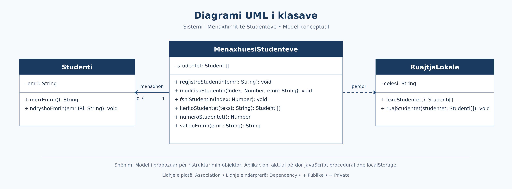

# Diagramet UML – Menaxhimi i Studentëve

**Lënda:** Inxhinieri Programesh  
**Seminar–Laboratori:** 2  
**Viti akademik:** 2026–2027

## 1. Diagrami Use Case

Paraqet aktorin dhe funksionalitetet
kryesore të sistemit.

[Hap diagramin e modifikueshëm](diagrami-rasteve-te-perdorimit.drawio)

[Lexo dokumentimin](USE_CASE.md)

---

## 2. Diagrami Activity

Paraqet rrjedhën e regjistrimit,
validimit dhe ruajtjes së studentit.

[Hap diagramin e modifikueshëm](diagrami-aktiviteteve-regjistrimi.drawio)

[Lexo dokumentimin](ACTIVITY.md)

---

## 3. Diagrami Class

Paraqet modelin objektor të propozuar
të sistemit.

[Hap diagramin e modifikueshëm](diagrami-klasave.drawio)

[Lexo dokumentimin](CLASS.md)

---

## Shënim

Diagrami Class përfaqëson modelin
e propozuar për zhvillimet e ardhshme.

Implementimi aktual përdor JavaScript
dhe localStorage.
